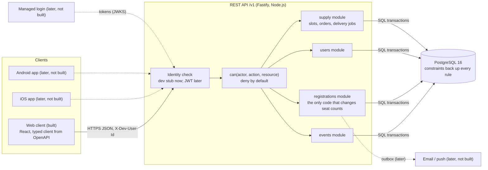
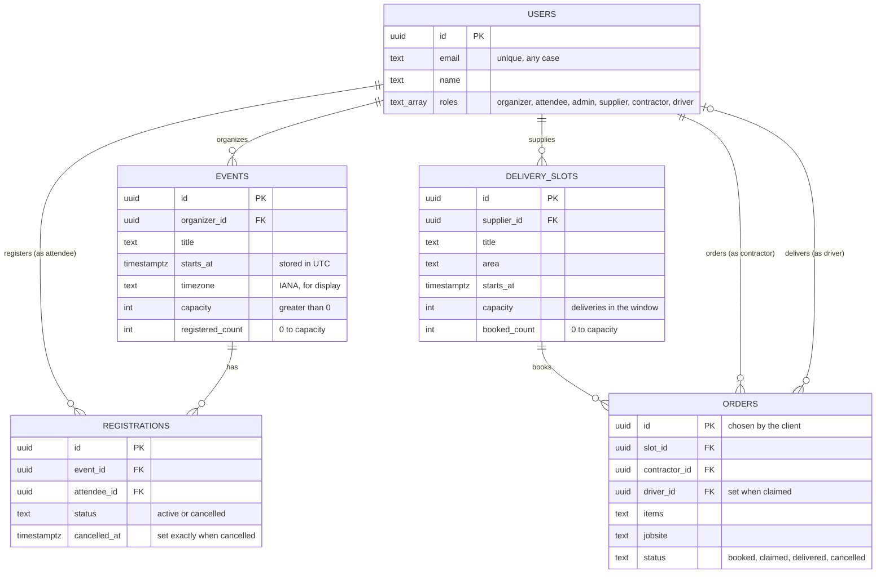
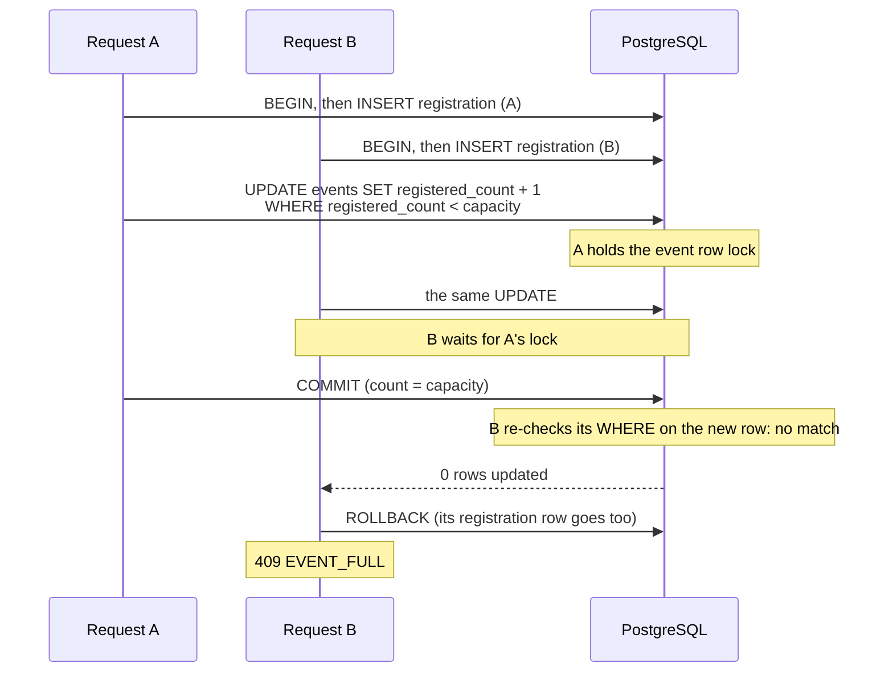

# Architecture

A platform for community events: organizers create events with a capacity, attendees register and cancel, admins oversee. The same API also runs a jobsite supply flow (section 11): suppliers publish delivery slots, contractors order material to a jobsite, and drivers take the delivery jobs. Web, iOS and Android clients all use one REST API. This build has the API, its database and a web client; the mobile apps, real sign-in and notifications are designed here but not built.

The rules this architecture serves are in [SPEC.md](SPEC.md). This page explains the structure and the choices.

## 1. System

## 2. How the backend, database and clients interact

1. **Contract first.** Every route declares its input and output with Zod. The same schemas validate requests, type the code and generate the OpenAPI contract ([openapi/openapi.json](../openapi/openapi.json), checked in CI). Clients are generated from it: the web client today (`web/src/api/schema.d.ts`), Swift and Kotlin clients later.
2. **One request.** A client calls `/v1/...` with the identity header. In order:
   - The identity hook loads the user and their roles from the database ([src/auth/devAuth.ts](../src/auth/devAuth.ts)). No user, no request (401).
   - The route asks `can(actor, action, resource)` ([src/auth/policy.ts](../src/auth/policy.ts)). Everything not allowed is denied (403).
   - The service runs the business rule as one SQL transaction. The database's constraints back up each rule.
   - The response is serialized through its declared schema, so only listed fields leave the server.
   - Any error becomes one `application/problem+json` shape with a stable `code` (SPEC section 7).
3. **Clients hold no rules.** The web client shows what the server answered; it never counts seats or checks roles (SPEC W1). A mobile app built later gets the same guarantees for free, because the rules live in one place.

The modules follow one layout: `routes.ts` (thin: parse, authorize, call, map), `service.ts` (the rule and the transaction), `repository.ts` (SQL with Kysely, a typed query builder that keeps the SQL visible), `schemas.ts` (Zod).

## 3. Core entities

- **One active registration per person per event** is a partial unique index (`WHERE status = 'active'`). A cancelled row stays as history, so the same person can register again.
- **Registrations are never deleted.** A trigger rejects `DELETE`, and the foreign keys use `ON DELETE RESTRICT`. The seat count can only change through the registration service. The one exception is the demo reset and the test setup, which empty all tables in one `TRUNCATE`, so counts and rows reach zero together.
- **`registered_count`** is stored on the event, with `CHECK (registered_count BETWEEN 0 AND capacity)`. Section 5 explains why a counter and not `COUNT(*)`.
- A person can hold several roles; an organizer who also attends has both.
- **Orders follow the same rules as registrations:** never deleted, `booked_count` kept by the supply service with a `CHECK` behind it, and a driver set exactly when the order is claimed or delivered (section 11).

## 4. How the user types access the system

The brief: *"Describe how you would enforce role-based authorization, but implementation is not required."* This build implements the authorization part (a real permission check on every request) and stubs only the identity part (who the caller is).

| Action (`can()` name) | Attendee | Organizer (owner) | Organizer (other) | Admin |
|---|---|---|---|---|
| See their own profile (`me:read`) | yes | yes | yes | yes |
| See events (`event:read`) | yes | yes | yes | yes |
| List started events (`event:list-past`) | no | no | no | yes |
| Create an event (`event:create`) | no | yes | yes | no |
| Change capacity (`event:update`) | no | yes | no | no |
| See who registered (`event:list-registrations`) | no | yes | no | yes |
| Register or cancel for oneself (`registration:self`) | yes | no | no | no |
| See their own registrations (`registration:list-own`) | yes | no | no | no |
| See delivery slots (`slot:read`) | yes | yes | yes | yes |
| Supply roles (`slot:create`, `slot:list-orders`, `order:own`, `job:work`) | see section 11 | | | |
| See all users with emails (`user:list`) | no | no | no | yes |
| **Designed, not built:** remove an attendee (`registration:remove`) | no | yes | no | yes |
| **Designed, not built:** suspend a user (`user:suspend`) | no | no | no | yes |

- **Now:** the client sends `X-Dev-User-Id`, a seeded demo user. The server runs only with `AUTH_MODE=dev-stub` and refuses to start otherwise (R9), so a real deployment cannot trust the header by accident.
- **Later:** a managed identity provider (Clerk, Auth0 or Cognito) signs users in and issues short-lived tokens (JWT). The API verifies them with the provider's public keys (JWKS) and maps the token's subject to our user. **Roles stay in our database**, so a role change takes effect on the next request and `can()` does not change at all.
- **Removing an attendee** (the brief's "manage registrations") reuses the cancel transaction with the organizer as the actor: same row update, same seat release, same lock order.
- **Suspending a user** (the brief's "manage users") sets a `suspended_at` column; the identity hook rejects suspended users, and the same transaction cancels their future registrations through the registration service, so seat counts stay correct.
- **Companies later:** organizations and memberships add one more argument to `can()` (the resource's organization) and a PostgreSQL row-level security policy as a second guard.

## 5. The last seat

Two people tap Register for the last seat at the same moment:

- **Why a conditional `UPDATE` on a counter.** Under PostgreSQL's default isolation (READ COMMITTED) the second `UPDATE` waits for the first, then re-checks its `WHERE` on the newest row. Exactly one request gets the last seat, with one short row lock and no retries. "Count the rows, then insert" lets both requests see one free seat.
- **Why not `SERIALIZABLE`.** It is also correct, but it makes the loser fail with a serialization error that the code must retry. Under a rush that means many retries for a result the counter gives directly.
- **When to switch to `SELECT ... FOR UPDATE` + `COUNT(*)`.** If seat holds with an expiry arrive (paid tickets), an expired hold should stop counting by itself, which a count over active-and-unexpired rows gives with no cleanup job.
- **The `CHECK` is the backstop**, not the mechanism: the guard gives users a clear 409; the constraint stops future code that forgets the guard.
- **Proof.** [test/integration/registrations.test.ts](../test/integration/registrations.test.ts) races 50 parallel registrations for 10 seats on real PostgreSQL with more pooled connections than calls; [test/integration/lock-wait.test.ts](../test/integration/lock-wait.test.ts) shows B waiting on A in `pg_blocking_pids`; [mutants/mutants.json](../mutants/mutants.json) removes each guard on purpose and CI checks a test fails. Lock order is the same in register and cancel (registration row, then event row), so they cannot deadlock.

## 6. Technology choices for an MVP

| Area | Choice | Why it fits an MVP |
|---|---|---|
| Language | TypeScript on Node.js 24 | One language for the API, the web client and React Native later; shared types from the contract. |
| API | Fastify 5 | Schema-first: one Zod schema validates, types and documents each route. Small, explicit, no DI container. Structured logs with request ids built in. |
| Database | PostgreSQL 16 | Transactions and constraints enforce the seat rule. Later: PostGIS for locations, full-text search, pgvector. |
| SQL | Kysely + plain SQL migrations | Typed queries, but the SQL that matters stays readable. An ORM would hide the conditional `UPDATE`. |
| Contract | OpenAPI 3.1 from the route schemas | Generated clients for web now, Swift and Kotlin later; CI fails if it drifts. |
| Tests | Vitest on real PostgreSQL | Race tests need real connections and real locks; mocks would serialize the writes. |
| Web | Vite, React 19, Tailwind CSS 4, shadcn/ui, TanStack Query | Fast to build, static files, a typed client. |
| Demo hosting | Vercel + Neon | No install for reviewers. Demo only (section 9). |

Not chosen: Express (no built-in validation or contract), NestJS (heavy for one engineer), Next.js API routes (tie the API to one web app; the mobile apps need a standalone API), Python/FastAPI (good, but a second language next to React).

## 7. MVP versus later

| MVP (this build) | Later, when it is needed |
|---|---|
| Events with capacity, register, cancel, retry-safe | Waitlists; paid tickets with seat holds |
| Real permission checks, dev identity stub | Managed login, MFA for admins, Sign in with Apple |
| Read-only admin | Suspend users, change roles, audit log |
| Web client | iOS and Android apps on the same contract |
| One region, one database | Read replicas, caching for read-heavy pages |
| Sentry for server errors, a request id on every log line, one uptime check, one count alert | Traces and dashboards when there is traffic to read them (section 9) |
| No notifications | Email and push through a queue with an outbox table |

## 8. Scaling, security and third parties

- **Scaling.** The API is stateless, so it scales out. Seat contention is per event row, so a hot event serializes its own registrations (about one short transaction each) while other events are unaffected. A connection pooler (PgBouncer, or the host's) keeps database connections bounded as instances grow. Add rate limits per user once there are real accounts. Set statement and lock timeouts per transaction (`SET LOCAL`, which works through a transaction-mode pooler) and answer 503 when one fires: today a stuck transaction would hold an event row until the host ends the request.
- **Security.** Identity from a verified token, never from the body. Deny-by-default `can()` on every route. Response allow-lists, so a new column never leaks. Security headers on every response (`@fastify/helmet`). Input limits on every field (R10). Secrets only in the host's environment.
- **Third parties.** Login (Clerk, Auth0 or Cognito), email (Postmark or SES), push (APNs and FCM), SMS (Twilio, with US business registration time planned in). All behind small interfaces, called from a queue rather than inside a request, so a provider outage never blocks a registration.

## 9. Demo hosting versus production

The live demo is for reviewing, not for production:

- **API:** one Vercel project; Fastify runs as one Function in `iad1`, next to the database. Its build applies migrations on production deploys ([scripts/vercel-build.ts](../scripts/vercel-build.ts)).
- **Web:** a second Vercel project ([web/vercel.json](../web/vercel.json)) serves the static build and forwards `/v1`, `/docs` and `/openapi.json` to the API project, so the browser sees one origin. (Vercel's Fastify preset sends every path to the function and does not serve a `public/` folder, so one project could not serve both.)
- **Database:** Neon PostgreSQL 16 (free tier, `aws-us-east-1`). Its pooled connection for the app, the direct one for migrations and the nightly reset.
- **Guards:** fake `@example.com` people only, no sign-up, a firewall rule of at most 400 writes per minute per IP, `noindex`, and a nightly reset with a live check ([.github/workflows/demo-ops.yml](../.github/workflows/demo-ops.yml)).
- **Monitoring:** every 30 minutes [monitor.yml](../.github/workflows/monitor.yml) calls `/v1/health`, then compares every stored count with its rows (`npm run check:counts`); a failed run emails whoever last changed its schedule (the repository owner). GitHub pauses schedules after 60 days without commits, so Sentry's uptime monitor also calls `/v1/health` every 20 minutes and opens an issue after 2 failures in a row. With `SENTRY_DSN` set (it is on the live API), server errors (500s) go to Sentry with their request id; without it they are only logged. Not every minute: the free database sleeps when idle, and each check wakes it.
- **Local copy:** `docker compose up --build` runs the same stack on one machine: PostgreSQL, a one-off setup (migrations, demo data), the API, and nginx serving the web client and forwarding the API paths, as the web project does here.

| Area | Demo now | Production | Add when |
|---|---|---|---|
| Accounts | Personal accounts | Company-owned GitHub org, Vercel team, cloud root with MFA, app store accounts | Before the first real user |
| Web hosting | Vercel Hobby | Vercel Pro team or any CDN | Before launch (Hobby is non-commercial) |
| API runtime | One Vercel Function | Vercel Functions on Pro; containers (for example ECS Fargate) for WebSockets, workers, long jobs. Same Fastify code. | When real-time or background work arrives |
| Database | Neon Free: sleeps when idle, small compute | Neon paid (always on) or RDS/Aurora; point-in-time restore; a separate staging database | Before launch |
| Identity | Dev stub | Managed login, JWT verified at the API, roles from our database | Before launch |
| Tenancy | None | Organizations and memberships; company check in `can()`; row-level security | With the first business customer |
| Background jobs | None | A queue (pg-boss first, SQS later) and an outbox table | With the first notification |
| Abuse protection | One firewall rule per IP | WAF rules and per-user limits in the API | Before launch |
| Monitoring | Sentry for server errors (O2), a request id on every log line (O1), uptime checks from Sentry (every 20 minutes) and GitHub, a count alert every 30 minutes (O3, [monitor.yml](../.github/workflows/monitor.yml)); host logs kept one hour | The same, plus log retention, uptime checks every minute from several regions, an on-call route | Before launch |
| Environments | One demo | Dev, staging, production; add-only migrations in CD | With the second engineer |
| Backups | Not needed (fake data) | Point-in-time restore, a tested restore, written recovery targets | Before launch |
| Infrastructure setup | CLI and dashboard | Terraform or Pulumi | With two or more environments |
| Data rules | Nightly wipe | Retention rules; in-app account deletion (the app stores require it) | Before the mobile launch |

**Path:** launch on managed platforms (Vercel Pro, Neon paid, managed login, Sentry), which is fastest for one engineer. Move the API into containers on AWS with RDS when the driver-style real-time features or background jobs arrive. The Fastify code does not change.

## 10. How mobile apps use the API

- **Generated clients.** Swift and Kotlin clients come from `openapi/openapi.json`, the same way the web client's types do.
- **Weak networks.** Register is `PUT .../registrations/me` and cancel is `DELETE`: both are safe to retry. A retried register returns the existing registration (200), a retried cancel changes nothing (204). A phone that resends on a bad connection never books twice and never sees an error for a booking that worked.
- **Stable errors.** Apps branch on `code` (`EVENT_FULL`, `EVENT_STARTED`...), never on message text.
- **Old app versions.** Responses may gain fields and clients ignore unknown ones (SPEC section 6); removing or renaming a field needs `/v2`. Request bodies reject unknown fields, so a typo in an app fails loudly in testing.
- **Time zones.** Times are UTC on the wire with the event's IANA zone, so each app shows the event's local time correctly anywhere.

## 11. Jobsite supply

The brief's hard part, a limited capacity under a rush, is also the hard part of construction supply. A second flow on the same API shows it, with the same structure: one module (`src/modules/supply`), one SQL transaction per write, a `CHECK` behind each guard, deny-by-default `can()`, and rules S1-S8 with tests named after them (SPEC section 14).

| Who | Can do | `can()` action |
|---|---|---|
| Supplier | Publish delivery slots: a time window with a fixed number of deliveries (one per truck) | `slot:create` |
| Supplier (owner), admin | See a slot's orders: contractor names, items, jobsites, never emails | `slot:list-orders` |
| Contractor | Order material to a jobsite in a slot, cancel it until a driver takes it, see their own orders | `order:own` |
| Driver | See open jobs, take one, mark it delivered | `job:work` |

- **The capacity (S1)** is the event pattern again: `UPDATE delivery_slots SET booked_count = booked_count + 1 WHERE booked_count < capacity`, so a truck is never promised to more jobsites than it can reach.
- **One driver per job (S4)** is one conditional `UPDATE orders SET driver_id = me WHERE status = 'booked' AND driver_id IS NULL`. Ten drivers tapping "Take this job" at once: one gets 200, nine get `409 JOB_TAKEN`. A cancel and a claim at the same moment both re-check `status = 'booked'` after the row lock, so only one of them goes through. The proof page runs this live.
- **Safe retries for phones on a jobsite (S2):** the app makes the order id itself and sends `PUT /v1/slots/{id}/orders/{orderId}`. A resend after a dropped connection returns the same order instead of booking a second truck.
- **Privacy (S7):** drivers see the items, the jobsite and the slot, never the contractor; suppliers see names on their own slots only.

**Later:** a real catalog per supplier instead of free-text items, prices and payment, live driver location (the reason to move the API into containers, section 9), photos at delivery, and organizations, so a contractor's whole company sees its orders. Each fits the same pattern: a new rule in the SPEC, a test named after it, then the smallest change.

